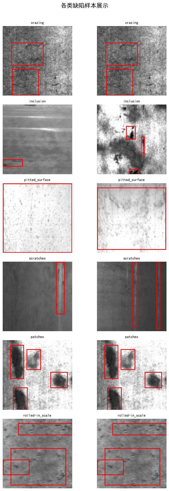
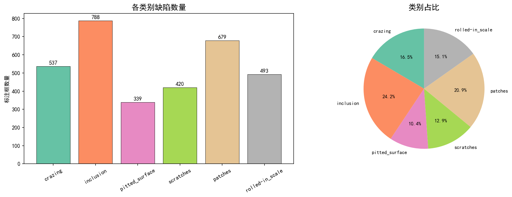
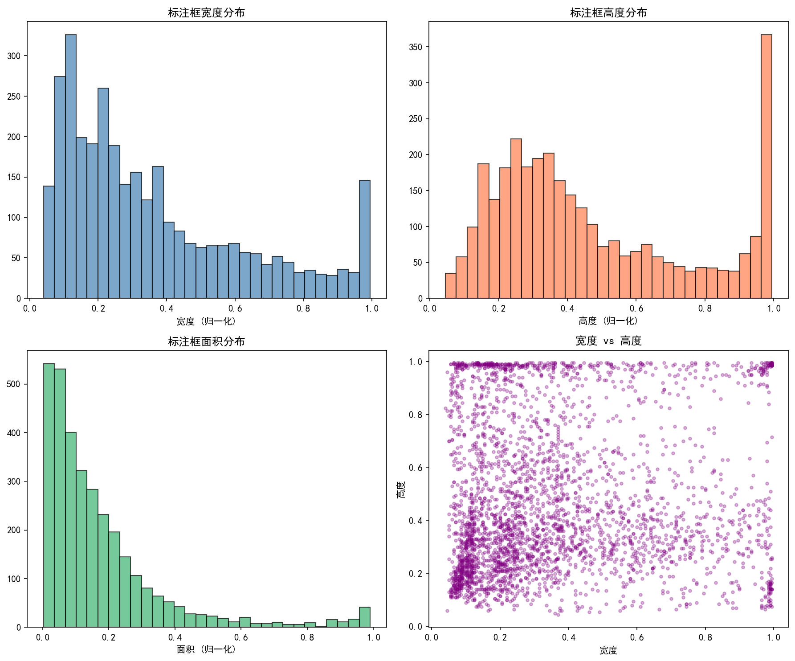
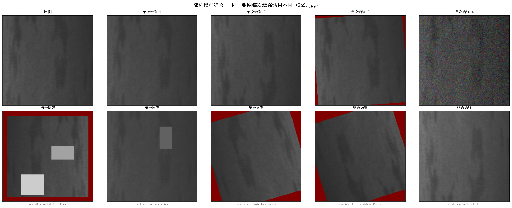

# AI 质检（钢铁表面缺陷检测工作台）

技术栈：YOLOv12（ultralytics）+ Qwen3.8-Omni-Flash（DashScope，OpenAI 兼容）+ Gradio + SQLite + matplotlib。

## 〇、仓库内容边界（重要）

本仓库包含代码、权重与文档，**不含数据集与运行时产物**：

| 未入库内容 | 原因 | 如何准备 |
| --- | --- | --- |
| `yolo-cases/steel_data/` | 1800 张钢铁缺陷图 + 标注，约 63MB | 放到该目录，保持 `train/images`、`train/labels`、`train/*.txt` 结构 |
| `venv/` | 虚拟环境约 2GB | `pip install -r requirements.txt` |
| `runs/`、`augmentation_output/`、`eda_output/`、`exports/` | 训练与可视化产物，可由脚本重跑 | 依次执行下面的运行步骤 |
| `inspection.db`、`temp_uploads/`、`gradio/` | 运行期数据与上传缓存 | 首次启动工作台时自动创建 |
| `dataset_local.yaml` | 内含本机绝对路径 | 由 `create_dataset_yaml()` 自动生成 |

其中 `models/best.pt` 已入库，克隆后可直接推理，无需自己训练。

## 一、本机实测结果

环境：Windows 11 / i9-13900HX（32 线程）/ RTX 4060 8GB（**实际用 CPU**，原因见问题清单 F8）/ Python 3.13 / torch 2.14.1+cpu / ultralytics 8.4.191

| 环节              | 结果                                                                     | 耗时            |
| --------------- | ---------------------------------------------------------------------- | ------------- |
| EDA 分析          | 1400 张图 / 3256 个标注框 / 6 类，不均衡比 **2.3:1**，平均 2.3 框/图 | 5s            |
| 数据增强可视化         | 生成 6 张对比图 + `yolo_augmentation_params.txt`                             | 8s            |
| YOLO 单图推理       | 自带 `models/best.pt` 加载正常（需 AAttn 补丁），CPU **~20ms/张**                   | 首次 13.8s（含预热） |
| 验证集评估           | mAP50 **0.708** / mAP50-95 0.362 / P 0.619 / R 0.727（仅 14 张 val，波动大）   | 1s            |
| 批量预测            | 400 张测试图 → `submission.csv`，**704 个检测框**                               | 30.5s         |
| YOLO 训练（CPU 冒烟） | 1 epoch @320px，158 iters，**1.7 it/s ≈ 102s/轮**                         | 2m19s         |
| VLM 零样本检测       | 改用 `qwen3.8-omni-flash`：能出框 + 自然语言描述；零样本**分类精度不足**（见问题清单 P11）          | 单图 9–40s      |
| Gradio 工作台      | 启动正常（HTTP 200），5 个 Tab 齐全；检测→审核→统计→导出 Bad Case 全流程走通                   | 启动 ~40s       |

> VLM 实测：`qwen3.8-omni-flash` 的 `bbox_2d` 是 0–1000 归一化，现有 `/1000*尺寸` 换算逻辑直接适用；
>
> `qwen3-vl-plus` 报 `403 Free quota exhausted`（免费额度用尽），`qwen3-vl-flash` 报 `404 Model not exist`，Omni 是当前唯一可用型号；
>
> `enable_thinking=False` 会让它直接回「图中不存在缺陷」，思维链只能保留，所以延迟降不下来。

## 二、结果展示

**数据集样例与分布**





**标注框分析**：框尺寸与位置分布，用于判断先验框尺寸是否合理、是否存在尺度失衡。



**数据增强对比**：左为原图，右为增强后，用于确认几何变换是否破坏了缺陷形态。



## 三、目录结构

```
ai-quality-inspection/
├─ app.py                    Gradio 工作台（5 Tab：缺陷检测 / 检测记录 / 统计分析 / 数据导出 / 批量预测）
├─ detection_engine.py       双引擎封装（YOLODetector / VLMDetector + 统一 DetectionResult）
├─ yolo_compat.py            YOLOv12 AAttn 兼容补丁（独立模块，供各入口复用）
├─ db_manager.py             SQLite 检测记录 + 审核状态
├─ data_export.py            Bad Case 导出 / 重训练数据导出
├─ eda_analysis.py           数据集 EDA
├─ augmentation_demo.py      数据增强可视化
├─ train_and_predict.py      训练 + 预测一体化（自动适配 CPU / CUDA）
├─ train_yolo_enhanced.py    6 种递进优化策略
├─ generate_submission.py    批量预测与结果导出
├─ test_vlm_detect.py        VLM 单图测试
├─ models/best.pt            训练好的 YOLOv12n 权重（5.4MB）
├─ docs/img/                 结果图（EDA 分布图、增强对比图等）
├─ submission.csv            批量预测结果示例
├─ requirements.txt
└─ 以下目录为运行时产物，不入库：
   yolo-cases/               数据集（1400 训练图 + 400 测试图 + 标注）
   eda_output/ augmentation_output/ runs/ exports/ temp_uploads/ gradio/
   dataset_local.yaml        指向本机数据路径，运行时生成
   inspection.db             检测记录数据库
```

## 四、运行步骤

```bash
# 1. 依赖（本机用独立 venv）
python -m venv venv && venv\Scripts\activate
pip install ultralytics gradio openai matplotlib pandas pyyaml albumentations opencv-python-headless

# 2. 数据分析
python eda_analysis.py            # → eda_output/
python augmentation_demo.py       # → augmentation_output/

# 3. YOLO 推理 / 评估 / 提交
python generate_submission.py --conf 0.25
python train_and_predict.py --predict_only --model ./models/best.pt
python train_and_predict.py --device cpu --epochs 1 --batch 8 --imgsz 320   # CPU 冒烟

# 4. VLM 零样本（需要可用的 DASHSCOPE_API_KEY）
python test_vlm_detect.py --image yolo-cases/steel_data/train/images/0.jpg

# 5. 工作台
python app.py                     # http://127.0.0.1:7860
```

## 五、每次改动（相对前一版）

| # | 文件                                                                           | 改动                                                         | 原因                                                                |
| - | ---------------------------------------------------------------------------- | ---------------------------------------------------------- | ----------------------------------------------------------------- |
| 1 | `yolo_compat.py`（新增）                                                         | 把 `detection_engine.py` 里的 `_patch_aattn_forward()` 抽成独立模块 | 原来补丁只在 `detection_engine` 里生效，凡是直接 `YOLO(权重)` 的脚本都会崩（详见问题清单 F1）   |
| 2 | `detection_engine.py`                                                        | 改为 `from yolo_compat import ...`                           | 保持行为不变，避免循环依赖                                                     |
| 3 | `generate_submission.py` / `train_and_predict.py` / `train_yolo_enhanced.py` | 顶部加 `import yolo_compat`                                   | 这三个入口都要加载 YOLOv12 权重                                              |
| 4 | `dataset_local.yaml`（生成）                                                     | 由 `create_dataset_yaml()` 指向本机路径                           | `yolo-cases/steel_data/dataset.yaml` 里写死的是 `/root/autodl-tmp/...` |

> 旧版代码未作其他改动；`models/best.pt`、数据、DB 历史记录都保留原样，方便对照。

## 六、已知问题

完整清单与证据见项目文档 `AI质检-问题清单.md`（共 10 条，按优先级排序）。

最需要你处理的三条：

1. **VLM 完全不可用**：DashScope 账号欠费（`400 overdue-payment`），需要充值或换 Key；否则 Tab1 的 VLM 引擎以及样本检测都过不了关。
2. **验证集只有 14 张**（train/val/test = 1260/14/126），mAP 抖动极大，练出来的模型没法评估；建议重划 8:1:1。
3. **有 GPU 却用不上**：装了 CPU 版 torch（`pytorch.org` 直连 403、阿里云镜像 404），RTX 4060 目前只能当摆设；完整训练仍得靠 AutoDL 或换可用的 CUDA 轮子源。
